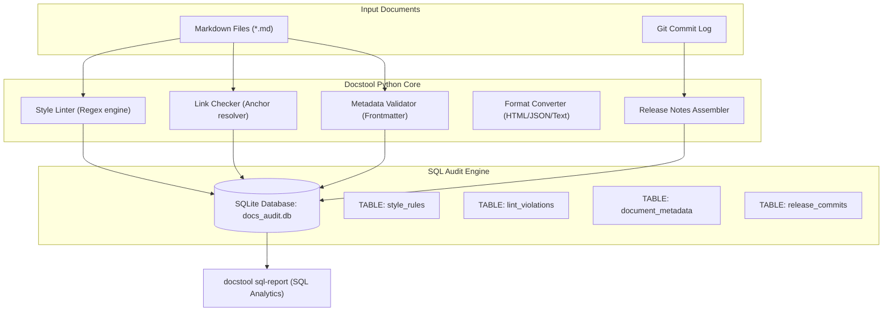

# Docstool: Technical Docs Linter & SQL Audit Engine

> **Coding Portfolio Project 2 of 3**  
> *Target Languages:* **Python** & **SQL (SQLite)**  
> *Target Domain:* Documentation Quality Assurance, Static Analysis, Git Automation, and SQL Reporting  
> *Author:* Er-Akash0053

---

## Architecture Overview

`docstool` is a command-line tool and automated audit engine written purely in **Python** and **SQL**. It provides automated quality assurance for Docs-as-Code pipelines by validating terminology against style guides, checking broken links and heading anchors, enforcing YAML frontmatter schemas, converting document formats, and assembling release notes from Git commits.



---

## SQL Database Schema & Queries

Docstool logs every audit run, violation, document metric, and release commit into an embedded SQLite database using pure SQL:

```sql
-- 1. Style rules definitions
CREATE TABLE style_rules (
    rule_id TEXT PRIMARY KEY,
    category TEXT NOT NULL,
    pattern TEXT NOT NULL,
    preferred_term TEXT,
    explanation TEXT NOT NULL,
    severity TEXT NOT NULL CHECK (severity IN ('ERROR', 'WARNING', 'INFO'))
);

-- 2. Audit run history
CREATE TABLE audit_runs (
    run_id INTEGER PRIMARY KEY AUTOINCREMENT,
    timestamp TEXT NOT NULL,
    target_dir TEXT NOT NULL,
    files_scanned INTEGER NOT NULL,
    total_issues INTEGER NOT NULL
);

-- 3. Detailed lint violations
CREATE TABLE lint_violations (
    violation_id INTEGER PRIMARY KEY AUTOINCREMENT,
    run_id INTEGER,
    file_path TEXT NOT NULL,
    line_number INTEGER NOT NULL,
    rule_id TEXT NOT NULL,
    severity TEXT NOT NULL,
    found_text TEXT NOT NULL,
    message TEXT NOT NULL,
    suggested_replacement TEXT,
    FOREIGN KEY (run_id) REFERENCES audit_runs (run_id)
);

-- 4. Content inventory with word count & reading time
CREATE TABLE document_metadata (
    file_path TEXT PRIMARY KEY,
    title TEXT,
    description TEXT,
    author TEXT,
    date TEXT,
    tags TEXT,
    word_count INTEGER DEFAULT 0,
    reading_time_min REAL DEFAULT 0.0,
    has_valid_frontmatter INTEGER DEFAULT 0
);

-- 5. Conventional Git commits for release notes
CREATE TABLE release_commits (
    commit_hash TEXT PRIMARY KEY,
    commit_type TEXT NOT NULL,
    scope TEXT,
    description TEXT NOT NULL,
    author TEXT,
    date TEXT,
    is_breaking INTEGER NOT NULL DEFAULT 0
);
```

### SQL Analytical Queries Featured in `docstool sql-report`:

1. **Top Violating Documents**:
   ```sql
   SELECT file_path, COUNT(*) AS issue_count,
          SUM(CASE WHEN severity = 'ERROR' THEN 1 ELSE 0 END) AS error_count,
          SUM(CASE WHEN severity = 'WARNING' THEN 1 ELSE 0 END) AS warning_count
   FROM lint_violations
   GROUP BY file_path
   ORDER BY issue_count DESC
   LIMIT 5;
   ```

2. **Issues Grouped by Category (SQL JOIN & GROUP BY)**:
   ```sql
   SELECT COALESCE(sr.category, 'structure') AS category, 
          COUNT(lv.violation_id) AS total_count,
          SUM(CASE WHEN lv.severity = 'ERROR' THEN 1 ELSE 0 END) AS errors
   FROM lint_violations lv
   LEFT JOIN style_rules sr ON lv.rule_id = sr.rule_id
   GROUP BY COALESCE(sr.category, 'structure')
   ORDER BY total_count DESC;
   ```

3. **Content Inventory & Reading Metrics**:
   ```sql
   SELECT file_path, title, word_count, reading_time_min, has_valid_frontmatter
   FROM document_metadata
   ORDER BY word_count DESC;
   ```

---

## CLI Usage & Commands

### 1. Lint Documentation
Scan a directory of Markdown files for style, broken links, and metadata errors:
```bash
python -m docstool.cli lint D:\technical-writing-portfolio\project-1-docs-site\docs
```
Add `--strict` to return exit code 1 if any errors are found (for CI/CD gating).

### 2. View SQL Audit Analytics Report
Generate instant SQL aggregation reports on the audit database:
```bash
python -m docstool.cli sql-report
```

### 3. Convert Markdown Formats
Convert Markdown documents to HTML, JSON AST, or clean plain text:
```bash
# Convert to Semantic HTML
python -m docstool.cli convert docs/sample.md --to html -o output.html

# Convert to JSON AST (for search engines or CMS ingest)
python -m docstool.cli convert docs/sample.md --to json -o output.json

# Convert to Plain Text (for LLM / RAG embeddings)
python -m docstool.cli convert docs/sample.md --to text -o output.txt
```

### 4. Assemble Release Notes from Git
Parse Conventional Commits (`feat:`, `fix:`, `perf:`, `BREAKING CHANGE:`) and compile a publication-ready Markdown release document:
```bash
python -m docstool.cli release-notes --repo D:\technical-writing-portfolio\project-1-docs-site --version v0.17.0 -o release-notes.md
```

---

## Running Unit Tests

Run the complete test suite with `pytest`:
```bash
python -m pytest tests -v
```
All tests validate regex matching, code block exclusion, relative path anchor resolution, frontmatter schemas, and SQL transactions.
